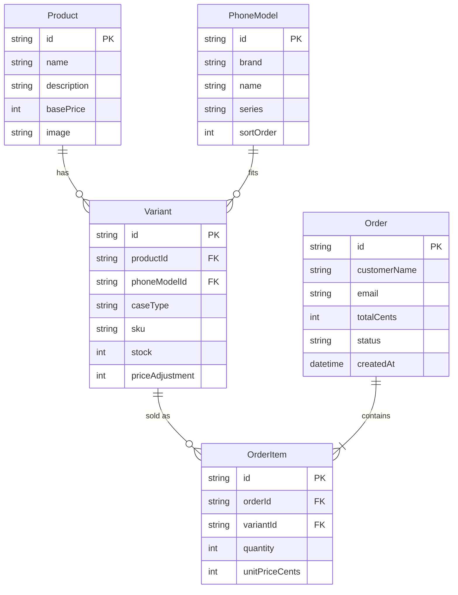

# CaseCraft: Database Documentation

**Engine:** SQLite (file `prisma/dev.db`), managed with the **Prisma ORM**.
**Schema source of truth:** `prisma/schema.prisma` (plain SQL version in `database/schema.sql`).
**Seed data:** `prisma/seed.ts` (6 designs, 59 phone models, 708 variants, ~30 sample orders).

## Entity-relationship diagram



## Tables

| Table | Purpose | Key columns |
|---|---|---|
| **Product** | A case *design* (artwork) | name, description, basePrice, image |
| **PhoneModel** | A supported phone (iPhone 11 to 18, Galaxy S20 to S26) | brand, name, series, sortOrder |
| **Variant** | The sellable item: design x phone x case type | sku (unique), stock, priceAdjustment |
| **Order** | A customer purchase | customerName, email, totalCents, status |
| **OrderItem** | One line of an order, with price/name snapshots | quantity, unitPriceCents |

## Design decisions (good points to mention to your teacher)

- **Normalised** into 5 tables: one design can fit many phones, so designs and phones are separate and joined by `Variant`.
- **Money stored as integers** (paisa) to avoid floating-point rounding errors.
- **Price snapshots** in `OrderItem` so old orders stay correct even if prices or products change later.
- **Server-side checkout in a transaction:** prices are re-read from the database, stock is checked and decremented atomically, then the order is saved. A customer can't tamper with prices from the browser.
- **Referential integrity:** deleting a Product cascades to its Variants, but a Variant or PhoneModel that has orders can't be deleted (`RESTRICT`).
- **Cancelling an order** returns its items to stock automatically (admin panel).
- **Order status** values: `PENDING`, `PAID`, `FULFILLED`, `CANCELLED`.

## Useful queries

```sql
-- Revenue (excluding cancelled orders), in rupees
SELECT SUM(totalCents) / 100.0 AS revenue_rs FROM "Order" WHERE status <> 'CANCELLED';

-- Best-selling designs
SELECT productName, SUM(quantity) AS sold FROM "OrderItem" GROUP BY productName ORDER BY sold DESC;

-- Low stock variants
SELECT sku, stock FROM "Variant" WHERE stock <= 5 ORDER BY stock;
```

Open the database visually with `npx prisma studio`.
